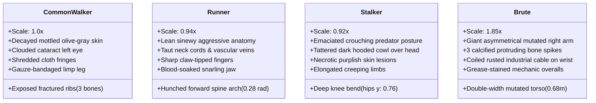

# ECLIPSE: THE LAST CIVILIZATION
## CHARACTER & ZOMBIE VISUAL REPORT (PHASE 2)

### 1. Ethan Cross — Protagonist Visual Transformation
Ethan Cross was redesigned from a generic polygonal mannequin into an experienced post-apocalyptic survivor inspired by *Left to Survive* and *The Last of Us*.

#### Detailed Anatomical & Tactical Features:
1. **Sculpted Head & Facial Structure:**
   - Anatomical jaw with chin cleft, brow ridge, and sculpted cheekbones.
   - Deep-set eyes with white sclera, blue-gray iris, black pupil, and eyelids.
   - Facial battle scar across left eyebrow and cheek (`0x8f4d45`).
   - Procedural 5-o'clock shadow beard stubble gradient across jawline and upper lip.
2. **Tactical Communications Headset:**
   - Overhead metal headband, cushioned ear cup on right ear, and articulated boom microphone with foam tip.
3. **Tactical Ballistic Vest & Modular Gear:**
   - Textured Kevlar armor with horizontal MOLLE webbing rows.
   - Upside-down combat knife in Kydex sheath strapped to left shoulder strap with pommel ring.
   - Shoulder tactical radio transceiver with antenna and coiled wire.
   - 3 chest ammunition pouches with visible 5.56 magazine feed lips.
4. **Clothing & Texture Details:**
   - Desaturated field crimson canvas jacket (`0x6e2624`) with woven fabric grain, seam stitching lines, weathered dirt wash, and rolled sleeves.
   - Olive-drab tactical cargo trousers with ripstop grid texture, thigh pockets, and dirt splashes.
   - Hard-shell tactical knee-pads with corner rivets and scuff marks.
5. **Holster, Boots & Rucksack:**
   - Right thigh dual-strap drop-leg tactical holster with quick-release buckles.
   - Operator tactical gloves with reinforced thermoplastic knuckle guards.
   - Tactical combat boots with sculpted rubber lugged outsoles.
   - Heavy survival rucksack with rolled khaki bedroll, metal survival canteen, and hatchet handle.

---

### 2. Infected Population — 4 Distinct Horror Classes

1. **Common Walker:**
   - Shambling urban victim with torn civilian workwear.
   - Asymmetrical decomposing skull with exposed teeth and rotten gums.
   - Dual-eye divergence: left eye blinded by cataract opacity (`0x9ba498`), right eye reflecting sickly biological infection tapetum lucidum.
   - 3 exposed fractured rib bones protruding through torn shirt chest laceration.
   - Right leg wrapped in blood-soaked field gauze.
2. **Runner:**
   - Feral athletic infected predator.
   - Lean, sinewy musculature with hyper-vascular dark branching infection veins.
   - Forward-hunched spine angle (0.28 rad) and extended neck cords.
   - Claws extending from fingertips for frenzied lunging attacks.
3. **Stalker:**
   - Unsettling ambush infected.
   - Low predatory crouch posture (hip height reduced to 0.76x) with bent legs.
   - Tattered dark hooded cowl wrapping around cranium, casting deep shadows over face.
   - Necrotic purplish-gray skin with fungal rot patches.
4. **Brute:**
   - Devastating mutated juggernaut (1.85x scale, 350 HP).
   - Massive asymmetrical upper body with gigantic right arm (2.4x standard arm volume).
   - 3 calcified bone spikes bursting through mutated shoulder and forearm.
   - Heavy rusted industrial steel cable coiled 3 times around right wrist.
   - Grease- and blood-stained heavy mechanic overalls.
