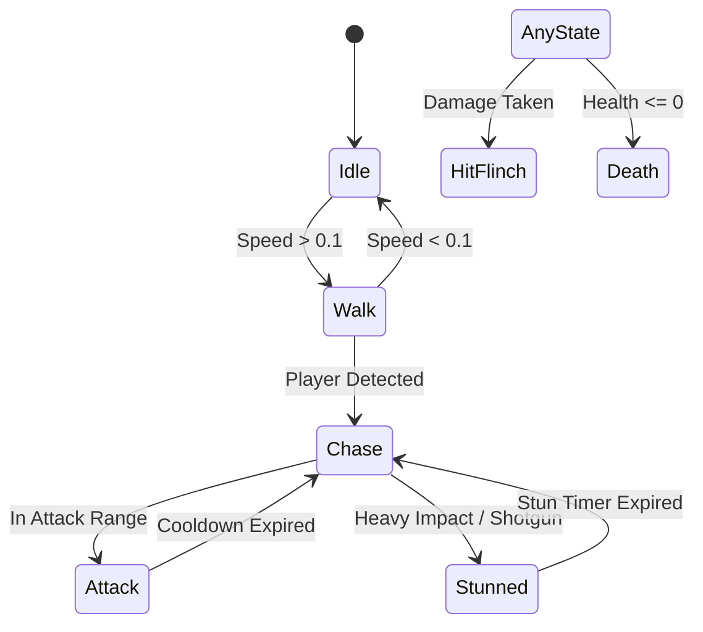

# ECLIPSE: THE LAST CIVILIZATION
# ZOMBIE ANIMATION PIPELINE & SKELETAL RIG SPECIFICATION
**Developer:** SVK Creationz  
**Target Engine:** Unity 6 (URP 17.0.3)  
**Animation Standard:** Humanoid Skeleton with Class-Specific Locomotion Blends  

---

## 1. Skeletal Hierarchy & Humanoid Compatibility

All four zombie classes utilize a standardized **Humanoid Skeletal Rig** (compatible with Unity Humanoid Mecanim, Blender, and Mixamo motion capture libraries), allowing shared root-motion and retargeted animation trees with per-class override controllers:

```
Hips (Root Motion)
├── Spine_01
│   └── Spine_02
│       └── Chest
│           ├── Neck -> Head -> Jaw (Dislocated Bone)
│           ├── LeftShoulder -> LeftUpperArm -> LeftForearm -> LeftHand -> Fingers [0..4]
│           └── RightShoulder -> RightUpperArm -> RightForearm -> RightHand -> Fingers [0..4]
├── LeftUpLeg -> LeftLeg -> LeftFoot -> LeftToeBase
└── RightUpLeg -> RightLeg -> RightFoot -> RightToeBase
```

- **Specialized Bones:**
  - `Jaw_Rot`: Allows dynamic jaw sagging, dislocated open-mouthed snarls, and bite snaps.
  - `Eye_Left_Bone` / `Eye_Right_Bone`: Anchors for emissive mesh spheres and particle flare attachments.
  - `Spur_Bone` (Brute/Alpha): Drives oversized bone growth and mutated claw attachments.

---

## 2. Animation Clip State Machine Matrix

| State Name | Walker Motion Profile | Runner Motion Profile | Stalker Motion Profile | Brute Motion Profile |
|---|---|---|---|---|
| **Idle** | Unstable twitching, sagging head | Agitated pacing, panting, hyper-tense | Low crouch, silent head pivots | Heavy breathing, chest heave, growl |
| **Walk** | Asymmetric limp, dragging left foot | Fast prowl, predatory forward lean | Silent crawling prowl, near ground | Earth-shaking stomp, shoulder roll |
| **Chase / Run** | Shuffling stumble, arms reaching forward | Full sprint (arms pumping, head low) | Rapid low scuttle, quick direction jukes | Aggressive charge with shoulder down |
| **Attack 01** | Two-handed claw swipe | Leaping lunge forward (mid-air claws) | Blindspot neck grab and bite | Horizontal right arm sweep (180°) |
| **Attack 02** | Forward neck bite attempt | Frenzied double-claw slash | Sudden upward gut rip | Overhead two-handed ground slam |
| **Flinch / Hit** | Slight stagger backward (head snaps) | Quick flinch without losing momentum | Fast evasive dodge / backward hop | Zero stagger from pistols; flinch on shotgun |
| **Stunned** | Disoriented stumble (2.0s) | Knee-fall recovery pause (1.0s) | Wall bounce / disoriented tumble (1.5s)| Arm deflect stance, bellowing roar (3.0s)|
| **Death** | Limp ragdoll collapse to ground | Forward tumble momentum slide | Fold inward, curl into fetal posture | Heavy backward crash with ground dust VFX |

---

## 3. Unity Animator Controller Architecture

Each zombie prefab references an `AnimatorOverrideController` deriving from `AC_Zombie_Master`:



- **Parameters:**
  - `Speed` (Float): Normalized velocity driving blend trees.
  - `IsChasing` (Bool): State trigger.
  - `AttackTrigger` (Trigger): Fires class-specific attack index.
  - `HitTrigger` (Trigger): Triggers flinch additive layer.
  - `DieTrigger` (Trigger): Transitions to death collapse.
  - `ClassType` (Int): `0: Walker`, `1: Runner`, `2: Stalker`, `3: Brute`.
