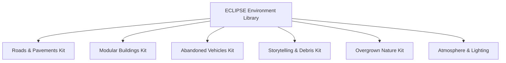

# ECLIPSE: THE LAST CIVILIZATION
# ENVIRONMENT ASSET INVENTORY & ASSET SPECIFICATION

**Document Version:** 1.0.0  
**Target:** Unity 6 Universal Render Pipeline (URP)  
**Lead Environment Artist:** SVK Creationz  
**Date:** October 2026  

---

## 1. INVENTORY OF CURRENT VS REQUIRED ASSETS

---

## 2. MODULAR ROAD & INFRASTRUCTURE KIT

| Asset ID | Description | Mesh Polycount | Material / Textures | LOD Setup |
| :--- | :--- | :--- | :--- | :--- |
| `SM_Road_Straight_20m` | 2-lane asphalt road segment with crown slope | 240 tris | `M_Road_Asphalt_Cracked` (Albedo, Normal, ORM) | LOD0: 240, LOD1: 80 |
| `SM_Road_Intersection_4Way` | 4-way urban crossroads with pedestrian crosswalks | 650 tris | `M_Road_Asphalt_Cracked` + Faded Decals | LOD0: 650, LOD1: 180 |
| `SM_Sidewalk_Straight_10m` | Concrete pedestrian sidewalk with raised curb stone | 120 tris | `M_Concrete_Sidewalk_Tiles` (Tileable PBR) | LOD0: 120, LOD1: 40 |
| `SM_Sidewalk_DrainGrate` | Cast-iron storm drain grate inset into curb | 180 tris | `M_CastIron_Rusted` | LOD0: 180, LOD1: 50 |
| `SM_Streetlight_Modern` | Standard municipal streetlight with cobra head fixture | 520 tris | `M_Metal_Painted_Weathered` + Emissive Glass | LOD0: 520, LOD1: 150 |
| `SM_TrafficLight_Overhead` | Overhead gantry traffic light with broken yellow hood | 840 tris | `M_Metal_HazardYellow` + Lens Glass | LOD0: 840, LOD1: 220 |
| `SM_FireHydrant` | Municipal cast-iron fire hydrant with chipping paint | 380 tris | `M_CastIron_RedPaint` | LOD0: 380, LOD1: 100 |

---

## 3. MODULAR ARCHITECTURE & BUILDING KIT

| Asset ID | Description | Mesh Polycount | Material / Textures | LOD Setup |
| :--- | :--- | :--- | :--- | :--- |
| `SM_Building_Apartment_01` | 4-story residential brick building with fire escape | 4,200 tris | `M_Brick_Weathered`, `M_Concrete_Trim`, `M_Glass` | LOD0: 4200, LOD1: 1800, LOD2: 600 |
| `SM_Building_Commercial_01`| 3-story retail shopfront with shattered display windows | 3,800 tris | `M_Concrete_Facade`, `M_Metal_ShopShutter` | LOD0: 3800, LOD1: 1500, LOD2: 500 |
| `SM_Building_ClinicEntrance`| Single-story emergency medical clinic entrance | 2,900 tris | `M_Tile_WhitePlaster`, `M_MedicalGlass` | LOD0: 2900, LOD1: 1100, LOD2: 400 |
| `SM_Building_GasStation` | Petrol station canopy, rusted fuel pumps, service mart | 5,100 tris | `M_PaintedSteel_OilStained`, `M_Concrete_Pavement` | LOD0: 5100, LOD1: 2200, LOD2: 750 |
| `SM_Rooftop_ACUnit` | Weathered air compressor condenser with rusty fan blade | 420 tris | `M_GalvanizedSteel_Rusted` | LOD0: 420, LOD1: 120 |
| `SM_Rooftop_WaterTower` | Cylindrical wooden water tower with steel hoops | 1,100 tris | `M_WoodPlanks_Weathered`, `M_Steel_Hoops` | LOD0: 1100, LOD1: 350 |

---

## 4. ABANDONED VEHICLES & TRANSPORTATION KIT

| Asset ID | Description | Mesh Polycount | Material / Textures | LOD Setup |
| :--- | :--- | :--- | :--- | :--- |
| `SM_Veh_PoliceCruiser_Damaged`| Sedan police cruiser, dented hood, open door, flat tires, siren bar | 4,800 tris | `M_CarPaint_Police`, `M_Glass_Fractured`, `M_Rubber_Tire` | LOD0: 4800, LOD1: 1900, LOD2: 650 |
| `SM_Veh_PickupTruck_Rusted` | Heavy 4x4 pickup truck, rusted flatbed, shattered windshield | 4,400 tris | `M_CarPaint_Rusted`, `M_Tire_Muddy` | LOD0: 4400, LOD1: 1700, LOD2: 580 |
| `SM_Veh_Sedan_Burned` | Evacuation family sedan, charred blackened hull, burned tires | 3,200 tris | `M_BurnedMetal_Soot`, `M_MeltedRubber` | LOD0: 3200, LOD1: 1200, LOD2: 400 |
| `SM_Veh_Ambulance_Emergency` | Paramedic ambulance, open rear doors, dropped stretcher ramp | 5,600 tris | `M_CarPaint_Ambulance`, `M_Glass_BloodStained` | LOD0: 5600, LOD1: 2100, LOD2: 700 |
| `SM_Veh_Motorcycle_Crashed` | Street motorcycle thrown on its side, cracked headlight | 2,600 tris | `M_Chrome_Scratched`, `M_Leather_Torn` | LOD0: 2600, LOD1: 950, LOD2: 300 |

---

## 5. ENVIRONMENTAL STORYTELLING & DEBRIS KIT

| Asset ID | Description | Mesh Polycount | Material / Textures | LOD Setup |
| :--- | :--- | :--- | :--- | :--- |
| `SM_Prop_JerseyBarrier_Concrete` | Heavy highway concrete barrier with bullet gouges | 180 tris | `M_Concrete_Gouged` | LOD0: 180, LOD1: 60 |
| `SM_Prop_Sandbag_Stack` | 3-tier curved sandbag defensive emplacement | 580 tris | `M_Burlap_Muddy` | LOD0: 580, LOD1: 160 |
| `SM_Prop_ScatteredLuggage` | Dropped hardshell suitcases, open duffel bag, clothes | 460 tris | `M_Leather_Luggage`, `M_Fabric_Clothes` | LOD0: 460, LOD1: 140 |
| `SM_Prop_MedicalStretcher` | Folded field stretcher with biological hazard stain | 340 tris | `M_Metal_Aluminum`, `M_Canvas_Stained` | LOD0: 340, LOD1: 90 |
| `SM_Prop_MilitaryCrate_Wooden` | Olive-drab military equipment crate with stenciled labels | 220 tris | `M_Wood_ArmyGreen` | LOD0: 220, LOD1: 70 |

---

## 6. OVERGROWN VEGETATION & NATURE RECLAIMING KIT

| Asset ID | Description | Mesh Polycount | Material / Textures | LOD Setup |
| :--- | :--- | :--- | :--- | :--- |
| `SM_Tree_Oak_Overgrown` | Mature broadleaf oak tree with mossy bark and ivy vines | 3,400 tris | `M_Bark_Oak_Mossy`, `M_Leaves_Overcast` (Two-Sided) | LOD0: 3400, LOD1: 1400, LOD2: 450 |
| `SM_Foliage_SidewalkGrassClump`| Clump of fescue grass and dandelions growing in road cracks | 120 tris | `M_Grass_Wild_Alpha` (Cutoff: 0.5) | LOD0: 120, LOD1: 40 |
| `SM_Foliage_BrambleBush` | Tangled roadside blackberry bush with thorn branches | 680 tris | `M_Bramble_Leaves` | LOD0: 680, LOD1: 220 |
| `SM_Foliage_CreepingIvy` | Wall-climbing English ivy patches for building facades | 380 tris | `M_Ivy_Climbing` | LOD0: 380, LOD1: 110 |
