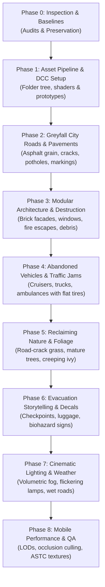

# ECLIPSE: THE LAST CIVILIZATION
# ENVIRONMENT UPGRADE PLAN & MULTI-PHASE IMPLEMENTATION ROADMAP

**Lead Architect:** SVK Creationz Development Team  
**Scope:** Transformation from flat prototype to realistic, atmospheric Greyfall County  
**Engine & Pipeline:** Unity 6 (6000.0.32f1 LTS) Universal Render Pipeline (URP 17.0.3)  
**Date:** October 2026  

---

## 1. PHASED IMPLEMENTATION STRATEGY

---

## 2. DETAILED BATCH SPECIFICATIONS

### Batch A: Core Environment Pipeline & Test Scene (Current Priority)
- Establish folder hierarchy: `Assets/ECLIPSE/Environment/`.
- Prototype road and sidewalk PBR materials with asphalt aggregate, cracks, and road striping.
- Implement modular building kit with multi-story relief, window frames, and fire escapes.
- Build first environment test scene and update live playable client.

### Batch B: Road Network & Street Infrastructure
- Multi-lane road system with realistic curvature, intersections, storm drains, and curbs.
- Weathered municipal infrastructure: streetlights, overhead traffic signals, fire hydrants, speed limit signs.
- Decal projection for oil stains, tyre skids, and pothole recesses.

### Batch C: Abandoned Vehicles & Evacuation Gridlock
- Model library: Police cruisers, family sedans, pickup trucks, ambulances, delivery vans.
- Damage states: Broken glass, flat tires, open doors, dented panels, rust, dust accumulation.
- Strategic placement: Gridlocked evacuation intersection, vehicles blocking lanes, crashed vehicles against curbs.
- NavMesh Obstacle integration to maintain zombie AI pathfinding.

### Batch D: Nature Reclaiming the City
- Vegetation placement in road cracks, sidewalk seams, and around abandoned car chassis.
- Mature oak trees, wild shrubs, and creeping ivy climbing building facades.
- GPU instanced grass rendering with wind vertex displacement.

### Batch E: Evacuation Checkpoint & Storytelling Scenes
- Handcrafted evacuation scene 1: Military quarantine checkpoint with Jersey barriers, sandbag nests, floodlights.
- Handcrafted evacuation scene 2: Hospital emergency entrance with abandoned ambulance, gurney, wheelchair.
- Handcrafted evacuation scene 3: Intersection gridlock with scattered personal belongings and luggage.

### Batch F: Atmospheric Lighting, Fog & Weather
- URP Volume Profile: ACES tonemapping, depth-based atmospheric fog, subtle bloom.
- Localized lighting: Flickering broken streetlights, emergency police beacons, warm window bounce.
- Weather transitions: Overcast daylight, foggy dusk, and dark apocalyptic night.

### Batch G: Mobile Optimization & Multi-Zone Scaling
- Setup 3-tier LOD Groups across all architectural and vehicle meshes.
- Configure ASTC 6x6 texture compression for mobile and BC7 for desktop.
- Setup Occlusion Culling data to cull non-visible street blocks.
- Profile and verify 30-60 FPS performance on target mobile devices.
