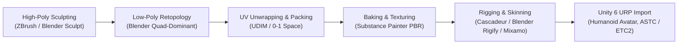

# ECLIPSE: THE LAST CIVILIZATION
# GRAPHICS ASSET PIPELINE & DIGITAL CONTENT CREATION (DCC) SPECIFICATION

**Document Version:** 1.0.0  
**Target:** Unity 6 Universal Render Pipeline (URP) & Mobile Scalability  
**Lead Technical Artist:** SVK Creationz  

---

## 1. DIGITAL CONTENT CREATION (DCC) WORKFLOW



### 1.1 Modeling & Geometry Standards
* **Humanoid Polygon Budgets:**
  * **Ethan Cross (Hero Character):**
    * LOD0: 25,000 - 32,000 Triangles (First-person arms & cinematic cutscenes).
    * LOD1: 14,000 - 18,000 Triangles (Standard third-person gameplay, 0 - 12m).
    * LOD2: 7,000 - 9,000 Triangles (Medium distance, 12 - 25m).
    * LOD3: 2,500 - 3,500 Triangles (Distant / multiplayer cull, 25m+).
  * **Infected / Zombies (Per Instance):**
    * LOD0: 12,000 - 16,000 Triangles.
    * LOD1: 6,000 - 8,000 Triangles.
    * LOD2: 2,000 - 3,000 Triangles.
    * LOD3: 800 - 1,200 Triangles.
* **Topology Guidelines:**
  * Clean edge loops around articulation areas (eyes, mouth, shoulders, elbows, knuckles, knees).
  * Minimum 3 edge loops per bending joint to prevent volume collapse during severe rotational deformation.
  * Symmetrical base topology for facial blendshapes, with asymmetric skin normal detailing.

### 1.2 Skeletal Rigging Standards
* **Rig Architecture:** Unity Humanoid compliant naming and orientation:
  * **Root / Pelvis:** `Root` -> `Hips`
  * **Spine Chain:** `Spine` -> `Spine1` -> `Spine2` -> `Chest` -> `Neck` -> `Head`
  * **Limbs (Left & Right):**
    * `Shoulder` -> `UpperArm` -> `LowerArm` -> `Hand`
    * Hand articulated into 5 digits: `Thumb_01-03`, `Index_01-03`, `Middle_01-03`, `Ring_01-03`, `Pinky_01-03`.
    * `UpperLeg` -> `LowerLeg` -> `Foot` -> `Toe`
  * **Weapon Attachment Sockets:** `Socket_Weapon_RHand`, `Socket_Weapon_Back`, `Socket_Sidearm_Holster`.
  * **Maximum Bone Influences per Vertex:**
    * Mobile Target: 4 bones per vertex (Linear Blend Skinning).

---

## 2. PBR TEXTURE & MATERIAL PIPELINE

### 2.1 Texture Map Budget & Packing Scheme
To maximize GPU cache efficiency on mobile Mali, Adreno, and Apple silicon, ECLIPSE utilizes packed ORM textures:

| Texture Slot | Channel | Data Content | Resolution (LOD0) | Resolution (Mobile) | Compression |
| :--- | :--- | :--- | :--- | :--- | :--- |
| **Albedo / BaseMap** | RGB | Diffuse Color (sRGB) | 2048 x 2048 | 1024 x 1024 | ASTC 6x6 / BC7 |
| **Alpha / Mask** | Alpha | Transparency / Detail Mask | Packed with Albedo | Packed | ASTC 6x6 / BC7 |
| **Normal Map** | RG | Tangent Space Normal (XY) | 2048 x 2048 | 1024 x 1024 | ASTC 5x5 / BC5 |
| **Mask Map (ORM)** | **R** | Ambient Occlusion | 2048 x 2048 | 1024 x 1024 | ASTC 6x6 / BC7 |
| | **G** | Roughness (Inverted Gloss) | Packed | Packed | ASTC 6x6 / BC7 |
| | **B** | Metallic Mask | Packed | Packed | ASTC 6x6 / BC7 |
| | **A** | Subsurface Scatter / Curvature | Packed | Packed | ASTC 6x6 / BC7 |

### 2.2 Material Sets per Character
* **Ethan Cross:**
  1. `M_Ethan_Head` (Skin, Subsurface scatter, Micro-pores, Eyes, Teeth).
  2. `M_Ethan_Hair` (Anisotropic hair cards with alpha clip).
  3. `M_Ethan_UpperBody` (Tactical combat shirt, ballistic vest, straps).
  4. `M_Ethan_LowerBody` (Cargo pants, knee pads, combat boots).
  5. `M_Ethan_Gear` (Backpack, holsters, radio, watch, combat knife).

---

## 3. ASSET DIRECTORY REORGANIZATION

```
Assets/_Project/
├── Models/
│   └── Characters/
│       ├── Player/
│       │   ├── Meshes/ (FBX / Procedural Generators)
│       │   ├── Textures/ (Albedo, Normal, ORM)
│       │   └── Materials/ (PBR Character Materials)
│       ├── Infected/
│       │   ├── Walker/
│       │   ├── Runner/
│       │   ├── Stalker/
│       │   ├── Brute/
│       │   └── AlphaBoss/
│       └── Survivors/
│           ├── SarahMitchell/
│           ├── MarcusVance/
│           └── ElenaRostova/
├── Shaders/
│   └── Character/
│       ├── CharacterSkinPBR.shader
│       ├── CharacterEyePBR.shader
│       └── CharacterHairPBR.shader
└── Prefabs/
    └── Characters/
        ├── EthanCross_Humanoid.prefab
        └── Infected/
```
