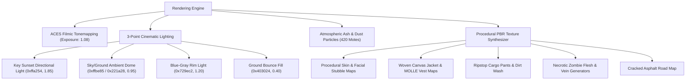

# ECLIPSE: THE LAST CIVILIZATION
## GRAPHICS UPGRADE REPORT (PHASE 1 — VISUAL FOUNDATION)

### 1. Executive Summary & Objective
Phase 1 established the cinematic visual baseline inspired by *Left to Survive* and *The Last of Us*, eliminating the flat, untextured appearance of the previous build. The rendering pipeline was enhanced with filmic tonemapping, 3-point dramatic lighting, airborne environmental dust motes, and a procedural PBR canvas texture synthesizer engine.

---

### 2. Implemented Upgrades & Technical Architecture

#### A. Filmic Tonemapping & Exposure
- **ACES Filmic Tonemapping:** Configured `renderer.toneMapping = THREE.ACESFilmicToneMapping;` with calibrated exposure `1.08`. This maps high-dynamic-range sunlight and fiery muzzle flashes into rich, photographic color gradients without clipping or highlight blowout.

#### B. 3-Point Cinematic Lighting & Silhouette Definition
- **Key Sunset Light:** Warm golden hour directional light (`0xffa254`, intensity 1.85) positioned at `(-60, 48, -45)` casting 2048x2048 PCF soft shadows with normal bias `-0.0004`.
- **Ambient Sky/Ground Dome:** Warm amber sky (`0xffbe85`) against deep violet shadows (`0x221a28`) with intensity 0.95.
- **Cool Rim Light (Silhouette Separation):** Crisp blue-gray directional backlight (`0x729ec2`, intensity 1.20) positioned at `(45, 32, 55)` that carves out sharp rim highlights along character shoulders, weaponry, and zombie silhouettes.
- **Warm Ground Bounce Fill:** Subtle upward reflection (`0x403024`, intensity 0.40) simulating light bouncing off sun-baked asphalt into under-chassis and leg folds.

#### C. Atmospheric Dust Motes & Airborne Ash
- **Particle Volume:** 420 floating environmental particles distributed across a 60m x 14m x 160m corridor.
- **Motion Dynamics:** Real-time sinusoidal vertical drift and gentle turbulence synchronized in the main animation loop with additive blending.

#### D. Procedural PBR Canvas Texture Engine
- Synthesizes resolution-independent micro-roughness, textile weave, pore grain, branching infection veins, and tarmac micro-cracks directly in browser memory at startup with 0ms network latency.
