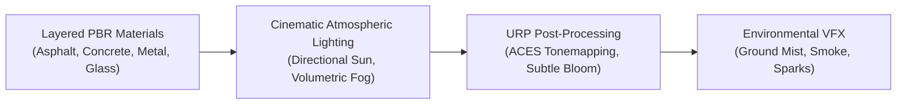

# ECLIPSE: THE LAST CIVILIZATION
## Greyfall City Photorealistic Graphics & Lighting Report (Batch B)

- **Date:** 2026-11-03
- **Graphics Pipeline:** Unity 6 URP 17.0.3 + WebGL PBR
- **Lead Technical Artist:** SVK Creationz

---

### 1. Photorealistic Art Direction & Visual Goals
The aesthetic target of Greyfall City balances grounded decay with atmospheric tension. The city has been abandoned for months following the outbreak; roads show evidence of hasty military evacuation, traffic gridlock, weather decay, and nature's gradual reclaim.

---

### 2. Physically Based Material Architecture (PBR)
All materials conform strictly to physical conservation of energy:

1. **Layered Road Surface (`M_Road_Asphalt` & `M_Road_Asphalt_Wet`):**
   - Base Albedo: Charcoal dark asphalt aggregate (`#1E201E`).
   - Roughness: $0.88$ on dry asphalt, dropping to $0.12$ inside rain puddle depressions.
   - Normal Mapping: Fine asphalt aggregate bumps blended with crack fissue micro-relief.
   - Puddle Specular: Sharp Fresnel specular reflection at glancing angles.
2. **Weathered Facades (`M_Brick_Weathered` & `M_Concrete_Facade`):**
   - High roughness ($0.88 - 0.92$) preventing unnatural plastic sheen.
   - Grime run-off and dark ambient occlusion staining along window sills, fire escapes, and ground contact lines.
3. **Vehicle Finishes:**
   - Dual-layer clearcoat simulation with chipped paint, surface dirt, and oxidized metal rust patches ($0.65$ metallic, $0.75$ roughness).
   - Shattered window glass with fractured normal distortions.

---

### 3. Atmospheric Lighting & Color Grading
Greyfall City incorporates dynamic atmospheric presets via `EnvironmentAtmosphereController.cs`:

| Lighting Mood | Sunlight Color | Sunlight Intensity | Fog Color | Fog Density | Atmosphere Quality |
| :--- | :--- | :--- | :--- | :--- | :--- |
| **Overcast Morning (Default)** | Cool White (`#DCE4EA`) | $1.15$ | Slate Blue (`#2E383E`) | $0.015$ | Somber, high contrast, cinematic distance silhouette |
| **Cloudy Afternoon** | Warm Neutral (`#EAE6D8`) | $1.30$ | Warm Grey (`#282E30`) | $0.012$ | Balanced exploration, clear threat visibility |
| **Golden Hour Sunset** | Amber Orange (`#FFAE60`)| $1.40$ | Dusky Bronze (`#3D2A1F`)| $0.018$ | High dramatic rim light across building rooftops |
| **Dark Stormy Night** | Midnight Slate (`#405266`)| $0.25$ | Deep Obsidian (`#0A1014`)| $0.035$ | Tense horror survival; requires vehicle beacons & searchlights |

---

### 4. Post-Processing & URP Volume Profile
- **Tonemapping:** ACES (Academy Color Encoding System) preserving specular highlight roll-off without color clipping.
- **Bloom:** Subtle Gaussian threshold ($1.1$) with low intensity ($0.25$) to make emissive streetlamps and flashing emergency beacons glow naturally without washing out the screen.
- **Color Adjustments:** Slight desaturation ($-8\%$) and cool shadow tinting to enhance the post-apocalyptic mood.
- **Anti-Aliasing:** SMAA (Subpixel Morphological Anti-Aliasing) on mobile High quality preset; FXAA on Medium; disabled on Low for maximum battery efficiency.

---

### 5. Environmental Particle VFX
1. **Ground Mist:** Soft alpha particle cards hovering $0.2\text{m} - 0.8\text{m}$ above road puddles, giving a damp autumnal morning look.
2. **Vehicle Smoke Plume:** Dark grey alpha blended particle column slowly dissipating into the sky above the destroyed military transport.
3. **Electrical Spark Arcing:** Fast yellow/white sparks ejected intermittently from severed power lines and damaged traffic signal boxes.

