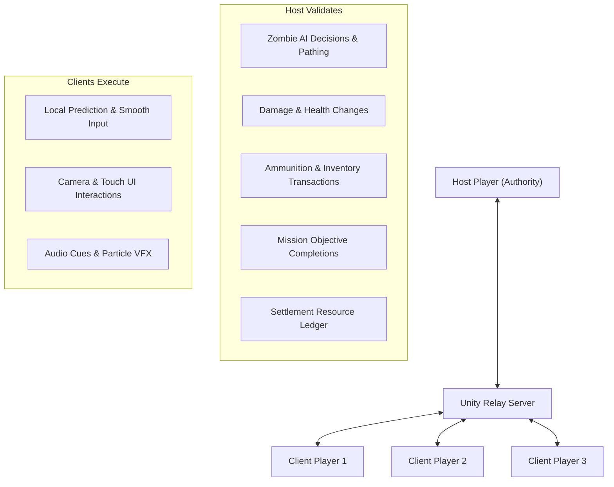

# ECLIPSE: THE LAST CIVILIZATION
## Part 3 — Network & Systems Architecture Specification

### 1. Multiplayer Networking Stack
- **Framework:** Unity Netcode for GameObjects (NGO 2.2.0)
- **Transport:** Unity Transport (UTP 2.4.0)
- **Signaling & NAT Punchthrough:** Unity Relay (eliminates port-forwarding requirements for mobile cellular/Wi-Fi)
- **Session Discovery:** Unity Lobby (room creation, 2–4 players, 6-character room join codes)
- **Authentication:** Unity Authentication (anonymous guest token or linked ID)

---

### 2. Network Authority Topology

---

### 3. Core Network Interfaces & Contracts
- `IPlayerIdentity`: Unique network client ID, display name, character preset, ping/latency.
- `INetworkAuthority`: Server/host authority validation contract for damage, loot, and progression.
- `IDamageable`: Networked health synchronization through `NetworkVariable<float>`.
- `IMissionParticipant`: Co-op mission participation and reward distribution.
