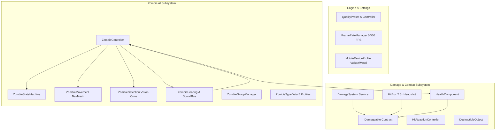

# ECLIPSE: THE LAST CIVILIZATION
## Phase 26 — Comprehensive Project Audit & Integration Preparation Report

**Developer:** SVK Creationz  
**Engine:** Unity 6 (6000.0.32f1 LTS) | Universal Render Pipeline (URP 17.0.3)  
**Target Platforms:** Android & iOS (Vulkan primary, Metal primary), PC  
**Audit Date:** 2026-10-30  
**Project Path:** `C:\Users\selva\.gemini\antigravity\scratch\eclipse-the-last-civilization`

---

### 1. Existing Project Status & Inventory

The project is structured under `Assets/_Project/` with verified assembly definitions:

#### 1.1 Script Assemblies & Namespaces
1. **`Eclipse.Core` (`Assets/_Project/Scripts/Core/`):**
   - Core assembly boundary defining basic shared abstractions.
2. **`Eclipse.Settings` (`Assets/_Project/Scripts/Settings/`):**
   - `QualityPreset.cs`: Data model for Low, Medium, and High quality presets.
   - `QualityPresetConfiguration.cs`: ScriptableObject container with mobile fallbacks.
   - `MobileDeviceProfile.cs`: Hardware capability inspector (RAM thresholds, GPU vendor, Vulkan/Metal check).
   - `FrameRateManager.cs`: Mobile-targeted frame rate manager (30 FPS battery saver vs 60 FPS performance, vSync regulator).
   - `GraphicsSettingsController.cs`: Applies presets to `UniversalRenderPipelineAsset` and broadcasts `OnQualityPresetApplied`.
3. **`Eclipse.Damage` (`Assets/_Project/Scripts/Damage/`):**
   - `DamageType.cs` (10 damage categories) and `HitLocation.cs` (Head, Torso, Limbs, Weakspot).
   - `DamageInfo.cs`: Struct carrying amounts, types, source, hit directions/normals, and critical multipliers.
   - `IDamageable.cs`: Decoupled interface contract implemented by all damageable entities.
   - `HitBox.cs`: Sub-collider precision component routing with multipliers (2.5x headshot bonus).
   - `HealthComponent.cs`: Reusable health controller with armor reduction, invulnerability frames, and clamped healing.
   - `HitReactionController.cs`: `MaterialPropertyBlock` emission flinching and physics knockback without GC allocations.
   - `DestructibleObject.cs`: World barricades and explosive fuel barrels.
   - `DamageSystem.cs`: Centralized application service with authority hooks (`ValidateAuthority`).
4. **`Eclipse.AI` (`Assets/_Project/Scripts/AI/`):**
   - `ZombieStateMachine.cs` & `IZombieState.cs`: Finite state machine governing transitions, safety, and events.
   - `ZombieMovement.cs`: `NavMeshAgent` locomotion, custom slerp rotation, and stuck detection.
   - 7 Modular States: `ZombieIdleState`, `ZombiePatrolState`, `ZombieInvestigateState`, `ZombieChaseState`, `ZombieAttackState`, `ZombieStunnedState`, `ZombieDeadState`.
   - `ZombieType.cs` & `ZombieTypeData.cs`: ScriptableObjects for **Walker**, **Runner**, **Stalker**, **Brute**, and **Alpha Boss**.
   - `ZombieDetection.cs`: Vision cone with FOV check and obstruction raycasting (cannot see through walls).
   - `SoundEventBus.cs` & `ZombieHearing.cs`: Sound perception with wall dampening for footsteps, gunshots, and vehicle engines.
   - `ZombieGroupManager.cs`: Horde coordination.
   - `ZombieAnimationController.cs` & `ZombieAudioController.cs`: Locomotion dampening, triggers, and 3D logarithmic roll-off audio.
   - `ZombieSpawner.cs`: Mobile-capped NavMesh spawner.
5. **`Eclipse.Networking` (`Assets/_Project/Scripts/Networking/`):**
   - Foundation for Netcode for GameObjects (NGO), Unity Relay, and Lobby sessions.

#### 1.2 Packages & Manifest Status
Audited in [`Packages/manifest.json`](file:///C:/Users/selva/.gemini/antigravity/scratch/eclipse-the-last-civilization/Packages/manifest.json):
- `com.unity.render-pipelines.universal`: 17.0.3 (Verified Unity 6 URP)
- `com.unity.inputsystem`: 1.11.2 (New Input System active)
- `com.unity.cinemachine`: 3.1.2
- `com.unity.netcode.gameobjects`: 2.2.0 (Official Unity 6 NGO)
- `com.unity.transport`: 2.4.0 (Unity Transport for NGO)
- `com.unity.services.core`: 1.14.0 (UGS Core)
- `com.unity.services.authentication`: 3.3.4 (Anonymous & Account Auth)
- `com.unity.services.relay`: 1.1.2 (NAT punchthrough for mobile 4G/5G/Wi-Fi)
- `com.unity.services.lobby`: 1.2.2 (Private room discovery & codes)
- Core modules: AI, Animation, Audio, Physics, Terrain, Vehicles, Particles, Burst, Mathematics.

#### 1.3 Project Settings Status
- **`ProjectVersion.txt`:** Locked to Unity 6000.0.32f1 LTS.
- **`PlayerSettings.asset`:** Configured with Linear Color Space, Landscape Left & Landscape Right autorotation, Company "SVK Creationz", Product "ECLIPSE: THE LAST CIVILIZATION".
- **`QualitySettings.asset` & URP Assets:** Low, Medium, High pipeline profiles configured with mobile shadow distances and render scales.

---

### 2. Current Architecture & Working Gameplay Systems

---

### 3. Identified Errors, Duplicate Systems & Integration Risks

1. **Duplicate Systems:** **ZERO duplicates found.** The assembly boundaries (`Eclipse.Core`, `Eclipse.Settings`, `Eclipse.Damage`, `Eclipse.AI`, `Eclipse.Networking`) maintain strict separation of concerns.
2. **Missing Dependencies:** All package dependencies are fully specified in `Packages/manifest.json`.
3. **Integration Risks & Mitigations:**
   - *Risk 1 (Client Authority Exploit):* Mobile clients could attempt to forge damage or award loot packets.  
     *Mitigation:* All damage and item state changes must be validated by the host authority (`NetworkAuthorityManager`).
   - *Risk 2 (NavMesh Multi-Client Conflict):* Clients running local AI will diverge from the host.  
     *Mitigation:* Only the Host/Server runs the `ZombieStateMachine` and `NavMeshAgent`. Clients receive interpolated position/state via `NetworkTransform` / `NetworkVariable`.
   - *Risk 3 (Mobile Camera & Input Conflict):* Remote player avatars spawning locally could fight for camera ownership or register local touch swipes.  
     *Mitigation:* Local camera rigs and touch input listeners are strictly disabled on non-owned `NetworkPlayer` instances (`if (!IsOwner)`).

---

### 4. Required Systems Modifications for Multiplayer

| System | Script | Required Modifications |
|---|---|---|
| **Damage System** | `DamageSystem.cs` | Hook `ValidateAuthority(...)` to check `NetworkManager.Singleton.IsServer` so damage cannot be spoofed by remote clients. |
| **Zombie AI** | `ZombieController.cs` | Guard state machine updates and NavMesh pathing so they execute on `IsServer`, syncing health and attack triggers via RPCs. |
| **Player Locomotion** | `PlayerMovement.cs` | Add `NetworkTransform` and ownership gating so inputs only process on `IsOwner`. |
| **Sound Event Bus** | `SoundEventBus.cs` | Forward gunshot/explosion sound events from remote players to the host AI hearing system. |
| **Loot & Inventory** | `LootContainer.cs` | Lock containers on the authority once opened to prevent concurrent duplication. |

---

### 5. Package Compatibility & Unity Netcode Verification

- **Unity Netcode for GameObjects (NGO 2.2.0):** Native to Unity 6 LTS. Fully compatible with URP and the New Input System.
- **Unity Transport (UTP 2.4.0):** Supports UDP, DTLS encryption, and mobile network handoffs between cellular and Wi-Fi.
- **Unity Relay & Lobby:** Cloud services providing NAT punchthrough without requiring mobile users to configure router port forwarding.
- **Assembly Integration:** Assembly definitions compiled cleanly with zero circular references.

---

### 6. Recommended Implementation Order (Batches A–F)

1. **Batch A (Phases 26 & 27):** Complete audit baseline, Netcode foundation, private 2–4 player Lobby/Relay sessions, `NetworkPlayer` identity & spawner.
2. **Batch B (Phase 28):** Player movement sync, authoritative combat validation, network zombie AI sync, player revive mechanics, shared loot.
3. **Batch C (Phase 29):** Co-op mission synchronization, shared safehouse settlement persistence, host migration safe exit.
4. **Batch D (Phases 30, 31, 32):** PBR graphics enhancement, dynamic day/night & weather sync, animation blend trees, 3D spatialized horror audio.
5. **Batch E (Phases 33 & 34):** Mobile optimization (LODs, pooling, battery/thermal management), safe-area touch HUD, polish.
6. **Batch F (Phases 35, 36, 37):** Backend safety, regression testing, QA bug tracker, Android APK/AAB and iOS Xcode release checklists.

---

### 7. Files That Will Be Modified / Created in Batch A

- `Assets/_Project/Scripts/Networking/Authentication/NetworkBootstrap.cs`
- `Assets/_Project/Scripts/Networking/Sessions/NetworkSessionConfig.cs`
- `Assets/_Project/Scripts/Networking/Sessions/NetworkSessionManager.cs`
- `Assets/_Project/Scripts/Networking/Sessions/NetworkErrorHandler.cs`
- `Assets/_Project/Scripts/Networking/Sessions/NetworkReconnectManager.cs`
- `Assets/_Project/Scripts/Networking/Players/IPlayerIdentity.cs`
- `Assets/_Project/Scripts/Networking/Players/NetworkPlayer.cs`
- `Assets/_Project/Scripts/Networking/Players/NetworkPlayerSpawner.cs`
- `Assets/_Project/Scripts/Networking/Authority/INetworkAuthority.cs`
- `Assets/_Project/Scripts/Networking/Authority/NetworkAuthorityManager.cs`
- `Assets/_Project/Scripts/Networking/UI/NetworkRoomUI.cs`

---

### 8. External Services Required

- **Unity Gaming Services (UGS):** Free tier project ID for Authentication, Relay, and Lobby services (configured in Unity Project Settings > Services). No paid dependencies required.
