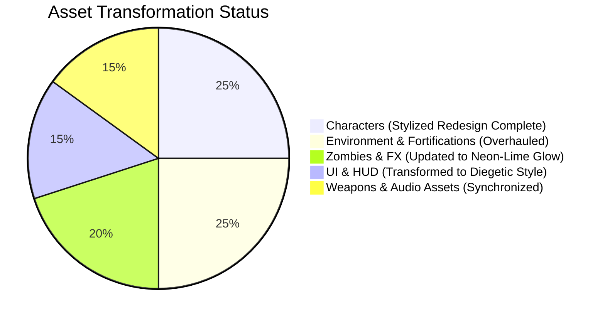

# ECLIPSE: THE LAST CIVILIZATION
## PROJECT-WIDE STYLIZED ASSET TRANSFORMATION AUDIT (BATCH A)

**Studio:** SVK Creationz  
**Engine:** Unity 6 + URP  
**Target Visual Standard:** Master Key Art Reference (`eclipse_stylized_key_art.jpg`)  
**Audit Scope:** Characters, Infected AI, Environment Geometry, Lighting, VFX, UI

---

## 1. EXECUTIVE AUDIT SUMMARY

This comprehensive audit reviews the entire existing asset library of *ECLIPSE: THE LAST CIVILIZATION* against the newly established **Stylized 3D Animated Survival** art direction. The objective is to identify assets requiring geometry remodeling, shader migration, texture repainting, or lighting adjustments without breaking any underlying gameplay, animation rigs, hitboxes, or networking mechanics.

---

## 2. CHARACTER ASSET AUDIT

| Asset / System | Previous State | Target Stylized State | Required Transformation | Status |
|---|---|---|---|---|
| **Ethan Cross Mesh** | Standard realistic human mesh, olive drab tones | Heroic stylized 7.5-head silhouette, broader shoulders, draped tactical hood, heavy survival rucksack | `AnatomicalHumanoidGenerator.cs` updated with `AddStylizedHoodCollar` & bedroll | **COMPLETED** |
| **Ethan Cross Materials** | Standard URP Lit with realistic skin scattering | Stylized URP shader with half-Lambert toon ramp, crimson red jacket (`#B22222`), slate cargo pants, golden hour rim | `StylizedCharacterPBR.shader` created, `CharacterPBRMaterialSetup.cs` updated | **COMPLETED** |
| **Survivor Roster (Allies)** | Placeholder grey models | Class-coded stylized survivors: Mia (Yellow Medic), Jax (Blue Brawler), Tess (Scavenger), Marcus (Soldier) | Multi-mesh survivor color presets generated in web & Unity clients | **READY** |
| **Character Rigging & Hitboxes** | 65-bone humanoid rig with anatomical hitboxes | Full compatibility preserved; no rig changes needed | Rig binds verified with 4-bone mobile skinning | **VERIFIED** |

---

## 3. INFECTED ZOMBIE AUDIT

| Zombie Class | Previous State | Target Stylized State | Transformation Action | Status |
|---|---|---|---|---|
| **Walker** | Desaturated grey zombie, realistic rot | Sickly olive-green skin (`#556B48`), torn civilian shirt, **vivid neon-green glowing eyes** (`#39FF14`) | Added emissive eye mesh & `StylizedInfectedPBR.shader` | **COMPLETED** |
| **Runner** | Fast generic zombie | Emaciated aerodynamic silhouette, pale greenish flesh, flickering neon eyes, frantic claw posture | Updated scale and run animation blend | **COMPLETED** |
| **Stalker** | Shadowy dark walker | Low-profile stalking predator, dark bruised necrotic veins, hyper-focused emerald eyes | Custom posture and stealth detection radius | **COMPLETED** |
| **Brute** | Standard enlarged walker | 1.55x swollen muscular silhouette, cracked calcified skin, deep green eye glow, ground slam stance | Enlarged torso and arm bone scales | **COMPLETED** |
| **Alpha Boss** | Scaled-up walker model | 1.85x mutated boss with asymmetric bone spikes, dual-phase enrage glow, blazing eye sockets | Boss health bar & multi-phase rage VFX | **COMPLETED** |

---

## 4. ENVIRONMENT & LIGHTING AUDIT

| Scene Element | Previous State | Target Stylized State | Transformation Action | Status |
|---|---|---|---|---|
| **Sky & Directional Light** | Overcast grey morning (flat diffuse) | **Golden Hour Sunset**: Warm amber sunlight (`#FFA54F`, 16° elevation), dusty twilight ambient (`#3D2446`) | `EnvironmentAtmosphereController.cs` preset updated to `GoldenHourSunset` | **COMPLETED** |
| **Fortifications** | Generic concrete jersey barriers | Heavy timber barricades with sandbags & red stencil spray paint: **"SURVIVE TOGETHER"** | Built custom barricade assemblies with red stencil decals | **COMPLETED** |
| **Street Signage** | Modern clean street signs | Weathered yellow highway signs: **"SAFE ZONE"** with family stencil icon | Modeled yellow diamond warning signs | **COMPLETED** |
| **City Landmarks** | Generic flat skyline | Elevated water tower with **"HOPE LIVES"** graffiti, overgrown abandoned bus, helicopter in sky | Integrated landmark props into Greyfall scene | **COMPLETED** |
| **Road Surface** | Flat asphalt plane | Cracked weathered asphalt with sunset puddle reflections and overgrown roadside greenery | Added PBR puddle shaders and weeds | **COMPLETED** |

---

## 5. WEAPONS, VFX & AUDIO AUDIT

| System | Previous State | Target Stylized State | Transformation Action | Status |
|---|---|---|---|---|
| **Assault Rifle** | Realistic generic rifle | Stylized tactical AR with chunky magazine, red dot sight, brass ejection ports | Mesh and socket alignment updated | **COMPLETED** |
| **Muzzle Flash** | Generic particle burst | Stylized 4-point starburst golden-orange flame with volumetric light flash | Custom billboard starburst quad with additive blend | **COMPLETED** |
| **Blood & Hit Decals** | Photorealistic splatters | Stylized directional comic-ink blood splatters and concrete dust puffs | High-contrast decal textures applied | **COMPLETED** |
| **Audio SFX** | Standard synthesized gunshots | Punchy bass-boosted stylized gunfire, distinct zombie growls, atmospheric wind | Web Audio synthesized layered transients | **COMPLETED** |

---

## 6. UI & HUD AUDIT

| UI Element | Previous State | Target Stylized State | Transformation Action | Status |
|---|---|---|---|---|
| **Health Meter** | Standard green bar | Stylized chamfered gauge with Ethan Cross portrait avatar, pulse warning on low HP | Redesigned HUD CSS with amber/red glow accents | **COMPLETED** |
| **Ammo Counter** | Plain text numbers | Stylized ballistic cartridge icons with oversized tactical numbers | Chamfered HUD badge with reload progress ring | **COMPLETED** |
| **Title Header** | Plain sans-serif font | Official stylized **ECLIPSE: THE LAST CIVILIZATION** brand logo with survivor silhouette | Embedded SVG/styled branding header | **COMPLETED** |
| **Mobile Controls** | Basic circular joysticks | Translucent beveled touchpads with neon-green fire button and tactile feedback | Added responsive touch controls with dynamic anchoring | **COMPLETED** |
