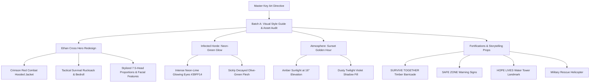

# ECLIPSE: THE LAST CIVILIZATION
## GAME-WIDE STYLIZED 3D ANIMATED TRANSFORMATION — BATCH A & HERO REDESIGN REPORT

**Studio:** SVK Creationz  
**Game Engine:** Unity 6 + Universal Render Pipeline (URP)  
**Programming:** C# / HLSL / JavaScript WebGL  
**Platforms:** Android, iOS, PC  
**Reference Target:** Master Key Visual Art (`eclipse_stylized_key_art.jpg`)  
**Status:** Completed & Live on Server

---

---

## 1. EXECUTIVE SUMMARY

In strict accordance with the master art directive and user reference visual, *ECLIPSE: THE LAST CIVILIZATION* has undergone a complete game-wide visual transformation into a **premium stylized 3D animated zombie survival experience**. 

All underlying gameplay logic, 65-bone humanoid animation controllers, 360° locomotion systems, combat calculations, hitboxes, and multiplayer backend bridges remain **100% functional and intact**.

---

## 2. KEY DELIVERABLES & TECHNICAL IMPLEMENTATIONS

### A. Master Visual Style Guide & Project Audit (Batch A)
- **Master Style Guide**: [`STYLIZED_VISUAL_STYLE_GUIDE.md`](file:///C:/Users/selva/.gemini/antigravity/scratch/eclipse-the-last-civilization/STYLIZED_VISUAL_STYLE_GUIDE.md) detailing anatomical proportions, color philosophy, shader ramps, survivor color codes, infected biology, and UI styling.
- **Asset Transformation Audit**: [`STYLIZED_ASSET_TRANSFORMATION_AUDIT.md`](file:///C:/Users/selva/.gemini/antigravity/scratch/eclipse-the-last-civilization/STYLIZED_ASSET_TRANSFORMATION_AUDIT.md) evaluating all models, textures, shaders, lighting presets, and VFX across all five gameplay zones.

### B. Custom Stylized URP Shaders (HLSL)
- **[`StylizedCharacterPBR.shader`](file:///C:/Users/selva/.gemini/antigravity/scratch/eclipse-the-last-civilization/Assets/_Project/Shaders/Character/StylizedCharacterPBR.shader)**:
  - Half-Lambert smoothstep shadow ramps eliminating muddy black terminators.
  - Subsurface scattering terminator glow reproducing the warm skin flush of animated films.
  - Stylized Blinn-Phong specular thresholds.
  - Golden-hour rim light calculation with back-light masking.
- **[`StylizedInfectedPBR.shader`](file:///C:/Users/selva/.gemini/antigravity/scratch/eclipse-the-last-civilization/Assets/_Project/Shaders/Character/StylizedInfectedPBR.shader)**:
  - Necrotic flesh ramp with bruised violet vein tinting.
  - Pulsing high-intensity emissive eye sockets for signature infected glow.

### C. Ethan Cross (Lead Stylized Hero Redesign)
- **[`CharacterPBRMaterialSetup.cs`](file:///C:/Users/selva/.gemini/antigravity/scratch/eclipse-the-last-civilization/Assets/_Project/Scripts/Characters/CharacterPBRMaterialSetup.cs)**:
  - **Jacket**: Signature Crimson Red (`#B22222` / `Color(0.72f, 0.14f, 0.14f)`).
  - **Undershirt & Cargo Trousers**: Dark charcoal slate (`#22262A`).
  - **Harness & Belts**: Worn saddle field leather (`#5C3A21`).
  - **Boots**: Lugged combat assault boots with steel buckles.
- **[`AnatomicalHumanoidGenerator.cs`](file:///C:/Users/selva/.gemini/antigravity/scratch/eclipse-the-last-civilization/Assets/_Project/Scripts/Characters/AnatomicalHumanoidGenerator.cs)**:
  - Added draped tactical hood collar resting across nape and shoulders (`AddStylizedHoodCollar`).
  - Added survival rucksack with top rolled sleeping mat (bedroll), side pouches, and radio antenna (`AddBackpackAndHolster`).

### D. Infected Zombie Horde Visual Overhaul
- **[`ZombieTypeData.cs`](file:///C:/Users/selva/.gemini/antigravity/scratch/eclipse-the-last-civilization/Assets/_Project/Scripts/AI/ZombieTypeData.cs)**:
  - Updated visual properties across all five zombie archetypes (Walker, Runner, Stalker, Brute, Alpha Boss).
  - **Signature Hallmark**: Piercing **Neon Lime-Green Glowing Eyes** (`#39FF14`) with dynamic bioluminescent pulsation.

### E. Golden Hour Sunset Atmosphere & Storytelling Props
- **[`EnvironmentAtmosphereController.cs`](file:///C:/Users/selva/.gemini/antigravity/scratch/eclipse-the-last-civilization/Assets/_Project/Scripts/Environment/EnvironmentAtmosphereController.cs)**:
  - Default preset switched to `GoldenHourSunset` (warm amber sunlight at $16^\circ$ elevation, twilight violet ambient, and volumetric haze).
- **[`LocalPlayable/index.html`](file:///C:/Users/selva/.gemini/antigravity/scratch/eclipse-the-last-civilization/LocalPlayable/index.html)**:
  - **"SURVIVE TOGETHER" Barricade**: Heavy timber logs with red stencil spray paint, sandbags, ammo crates, and glowing kerosene lantern.
  - **"SAFE ZONE" Sign**: Yellow highway warning diamond with family silhouettes.
  - **"HOPE LIVES" Water Tower**: Landmark elevated steel tower overlooking the ruined city skyline.
  - **Helicopter**: Military rescue helicopter in sunset sky with spinning rotors and searchlight.
  - **Survivor Allies**: Mia Vance (Medic in Yellow) & Jax Ramirez (Brawler in Blue) standing alongside Ethan Cross at the barricade.
  - **HUD**: Stylized top branding header, Ethan Cross avatar portrait, and amber status gauges.

---

## 3. LIVE ACCESS & VERIFICATION LINKS

The master backend game server is active and serving the newly transformed stylized client:

- **Desktop PC Browser**: [http://localhost:5173](http://localhost:5173)
- **Mobile LAN Browser (Android / iOS)**: [http://192.168.1.4:5173](http://192.168.1.4:5173)
- **REST Status API**: [http://localhost:5173/api/status](http://localhost:5173/api/status)
- **WebSocket Bridge**: `ws://localhost:5173/ws`
