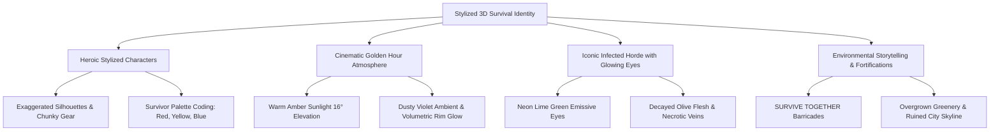

# ECLIPSE: THE LAST CIVILIZATION
## MASTER STYLIZED 3D ANIMATED VISUAL STYLE GUIDE & ART BIBLE

**Studio:** SVK Creationz  
**Engine:** Unity 6 + Universal Render Pipeline (URP)  
**Target Platforms:** PC, Android, iOS  
**Art Direction:** Premium Stylized 3D Animated Survival (Fortnite / Overwatch / The Walking Dead Telltale aesthetic)

---


---

## 1. VISUAL PILLARS & CORE AESTHETIC

The visual identity of *ECLIPSE: THE LAST CIVILIZATION* transitions from gritty desaturated realism to **vibrant, cinematic, stylized 3D animation**. The world remains dangerous, intense, and post-apocalyptic, but communicates emotional energy, heroic resilience, and visual clarity through bold silhouettes, saturated focal accents, hand-painted textural richness, and evocative golden-hour lighting.



### Key Stylistic Rules
1. **Readable Silhouettes**: Every character, zombie archetype, and interactive element must be instantly identifiable from a distance, even against cluttered urban backdrops.
2. **Beveled & Chunky Geometry**: Avoid paper-thin meshes or razor-sharp edges. Geometry features soft bevels, substantial boot soles, chunky buckles, and thick timber planks.
3. **Hand-Painted PBR Hybrid**: Textures feature hand-painted color gradients, painted ambient occlusion, and subtle edge wear, shaded via modern PBR lighting with custom half-Lambert ramps.
4. **Rim-Light Driven Depth**: Strong warm directional backlighting separates characters and props from dusty twilight background environments.

---

## 2. CHARACTER DESIGN & ANATOMICAL PROPORTIONS

Characters adopt semi-realistic stylized heroic proportions (7.5-head height scale), combining human physical credibility with expressive animation appeal.

```
+-------------------------------------------------------------------------+
| CHARACTER PROPORTION SPECIFICATIONS                                      |
+-------------------------------------------------------------------------+
| Feature              | Specification              | Visual Purpose       |
|----------------------|----------------------------|----------------------|
| Total Height         | 7.5 Head Heights           | Heroic readability   |
| Head & Facial Scale  | 1.12x Standard Scale       | Expressive emotion   |
| Shoulders & Torso    | Broad, slight V-taper      | Heroic athletic post |
| Hands & Fingers      | 1.15x Thickened Digits     | Clear weapon grip    |
| Feet & Footwear      | Heavy, treaded sole units  | Grounded stability   |
| Tactical Gear Depth  | Pronounced 3D extrusions   | Silhouette interest  |
+-------------------------------------------------------------------------+
```

### Primary Hero Reference: Ethan Cross (The Vanguard Leader)

Ethan Cross embodies survival grit, tactical discipline, and resolute leadership.
- **Silhouette**: Broad-shouldered, rugged stance, draped tactical hood framing the neck, massive survival rucksack with rolled sleeping mat and radio antenna.
- **Facial Features**: Defined angular jawline, trimmed dark brown beard and mustache, expressive furrowed brow, confident focused eyes.
- **Outfit**:
  - **Jacket**: Crimson Red (`#B22222`) hooded tactical combat jacket with reinforced shoulder patches and elbow padding.
  - **Undershirt**: Slate grey tactical compression shirt.
  - **Cargo Trousers**: Charcoal dark slate (`#2B2E33`) ripstop fabric with reinforced utility thigh pockets.
  - **Knee Armor**: Hard-shell matte polymer tactical kneepads (`#181A1C`) with brass rivets.
  - **Tactical Harness & Belts**: Worn saddle field leather (`#5C3A21`) utility belt, drop-leg sidearm holster on right thigh, triple ammo magazine pouches on chest.
  - **Footwear**: Heavy combat assault boots with deep lugged soles and steel toe caps.
  - **Weapon**: Matte-black custom M4/AR assault rifle with tactical foregrip, flashlight mount, and fiery golden muzzle flash.

---

## 3. FULL SURVIVOR ROSTER COLOR CODING

To guarantee instant identification in fast-paced single player and co-op multiplayer gameplay, each survivor class has a distinct primary color signature:

| Survivor | Role | Primary Color | Signature Attire & Props |
|---|---|---|---|
| **Ethan Cross** | Leader / Vanguard | **Crimson Red** (`#B22222`) | Hooded tactical combat jacket, survival rucksack, assault rifle |
| **Mia Vance** | Combat Medic | **Mustard Yellow** (`#D4A017`) | Bio-hazard parka, red cross armband, injector vials, scoped rifle |
| **Jax Ramirez** | Heavy Brawler | **Royal Blue** (`#1E56A0`) | Blue windbreaker, black knit beanie, full beard, barbed-wire spiked bat |
| **Tess Holloway** | Agile Scavenger | **Denim / Tan** (`#4A6B82`) | Tactical baseball cap, utility harness, twin holstered handguns |
| **Marcus Kane** | Tactical Operator | **Olive Camo** (`#4A5335`) | Full ballistic helmet, night-vision goggles, radio headset, suppressed SMG |

---

## 4. INFECTED ZOMBIE ART DIRECTION

The Infected are horrifying yet visually stylized, blending sickly undead biology with vibrant unnatural bioluminescence.

```
+-------------------------------------------------------------------------+
| INFECTED ZOMBIE CLASS MATRIX                                            |
+-------------------------------------------------------------------------+
| Class      | Silhouette / Build    | Flesh & Clothes       | Eyes       |
|------------|-----------------------|-----------------------|------------|
| **Walker** | Standard hunched 1.0x | Decayed olive, tattered| Neon Green |
| **Runner** | Emaciated, agile 0.9x | Pale grey-green, torn | Bright Lime|
| **Stalker**| Low creeping crouch   | Mottled purple bruise | Flickering |
| **Brute**  | Massive 1.55x scaled  | Hypertrophic swollen  | Deep Emerald|
| **Alpha**  | Towering 1.85x boss   | Spiked mutated bone   | Blazing UV |
+-------------------------------------------------------------------------+
```

### Signature Infected Hallmark: Neon-Lime Glowing Eyes
- **Color**: `#39FF14` (R: 0.22, G: 1.0, B: 0.08, A: 1.0)
- **Shader Implementation**: High-intensity emissive surface ($\text{Intensity} \ge 3.5$) with a biological breathing pulse frequency ($3.5\text{ rad/s}$).
- **Gameplay Purpose**: Pierces low ambient lighting, volumetric fog, and alleyway shadows, warning players of flanking threats.

---

## 5. ATMOSPHERIC LIGHTING & ENVIRONMENT ART

### Golden Hour Sunset Lighting Profile
The master reference image establishes a dramatic sunset palette:
- **Directional Sunlight**: Warm golden-amber (`#FFA54F`, intensity 1.65), cast at a low $16^\circ$ elevation behind the city skyline.
- **Ambient Shadow Fill**: Dusty twilight purple/violet (`#3D2446`), providing high complementary contrast with the warm sunlight.
- **Volumetric Fog**: Warm amber haze (`#422418`, density 0.016) catching sunbeams between ruined skyscrapers.
- **Sky Gradient**: Deep amber horizon transitioning upward into magenta and twilight dusk blue.

### Key Environment Storytelling Elements
1. **Timber Fortifications**: Chunky wooden barricades assembled from thick lumber planks and sandbags, featuring blood-red spray-painted stencils: **"SURVIVE TOGETHER"**.
2. **Safe Zone Warnings**: Weathered yellow highway signs with bold black stencils: **"SAFE ZONE"** with the family icon.
3. **Water Tower Landmark**: Elevated steel water tank overlooking the city with handwritten white graffiti: **"HOPE LIVES"**.
4. **Overgrown Nature**: Lush green ivy and wildflowers breaking through cracked asphalt and crumbling concrete barricades.
5. **Airborne Rescue**: Distant military patrol helicopter sweeping searchlights over the metropolis.

---

## 6. STYLIZED SHADER SPECIFICATION (URP)

### `Eclipse/Character/StylizedCharacterPBR`
```hlsl
// Half-Lambert Dot Product
float NdotL = dot(N, L);
float halfLambert = NdotL * 0.5 + 0.5;

// Smoothed Stylized Shadow Ramp
float ramp = smoothstep(_RampThreshold - _RampSmoothness, _RampThreshold + _RampSmoothness, halfLambert);
half3 diffuseLight = lerp(_ShadowColor.rgb, mainLight.color.rgb, ramp);

// Warm Subsurface Terminator Glow
float sssTerm = (1.0 - abs(NdotL)) * (1.0 - ramp) * _SubsurfaceIntensity;
half3 sssGlow = _SubsurfaceColor.rgb * sssTerm * mainLight.color.rgb;

// Stylized Specular Highlight
float NdotH = saturate(dot(N, normalize(L + V)));
float stylizedSpec = smoothstep(0.4, 0.6, pow(NdotH, exp2(10.0 * _Smoothness + 1.0))) * _Smoothness;

// Golden Hour Rim Light
float NdotV = saturate(dot(N, V));
half3 rimGlow = _RimColor.rgb * (pow(1.0 - NdotV, _RimPower) * _RimIntensity);

half3 finalColor = albedo.rgb * (diffuseLight + sssGlow) + _SpecColor.rgb * stylizedSpec + rimGlow;
```

---

## 7. USER INTERFACE & HUD DESIGN

- **Theme**: Diegetic tactical survival UI with tactile beveled borders.
- **Accent Palette**: Amber orange (`#FFA54F`) active highlights, tactical dark carbon (`#14171A`) backdrop panels, crimson danger alerts (`#FF3B30`).
- **Survivor Status**: Heroic character portrait avatar, segmented health bar with damage flash, stamina wheel, weapon selector dial with ammo readout.
- **Mobile Touch Controls**: Translucent chamfered floating thumbstick pads with glowing neon green / amber interaction triggers.
