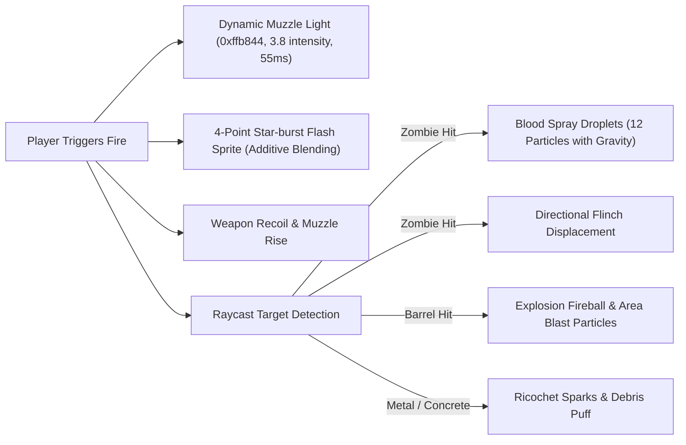

# ECLIPSE: THE LAST CIVILIZATION
## VFX IMPLEMENTATION REPORT (PHASE 4 — COMBAT & WEAPONS)

### 1. Weapon Models & Realism
The firearms in ECLIPSE were upgraded to tactical military specifications:

1. **9mm Tactical Combat Pistol:**
   - Two-tone slide with machined front and rear cocking serrations.
   - Under-barrel accessory Picatinny rail with tactical laser/flashlight module.
   - Textured stippled ergonomic grip and extended magazine baseplate.
   - Reciprocating slide kick and barrel geometry.
2. **M4 Tactical Carbine:**
   - Telescoping multi-position Crane stock with buffer tube.
   - Quad-rail handguard with ladder rail covers.
   - Angled forward tactical foregrip (AFG) gripped by Ethan's left hand.
   - Holographic red dot reflex sight with protective hood and illuminated reticle.
   - Curved 30-round ribbed polymer magazine and birdcage muzzle brake.

---

### 2. Combat VFX Architecture

#### Detailed VFX Specifications:
- **Dynamic Muzzle Illumination:** A high-intensity point light (`0xffb844`, intensity 3.8) illuminates Ethan Cross, his weapon, and nearby walls for 55 milliseconds on each shot.
- **Star-Burst Muzzle Flash Geometry:** Two interlocking planes with additive alpha glow, randomly rotated on each trigger pull to simulate high-velocity propellant gas combustion.
- **Directional Blood Droplets:** Hits on zombie targets spawn 12 high-velocity blood droplets that radiate from the impact point, arc downward under gravitational acceleration (`-9.8 m/s²`), and despawn upon hitting ground level.
- **Barrel Explosions:** Explodable fuel barrels trigger expanding fireball shockwaves, radius damage (150 HP), and cascading zombie eliminations.
